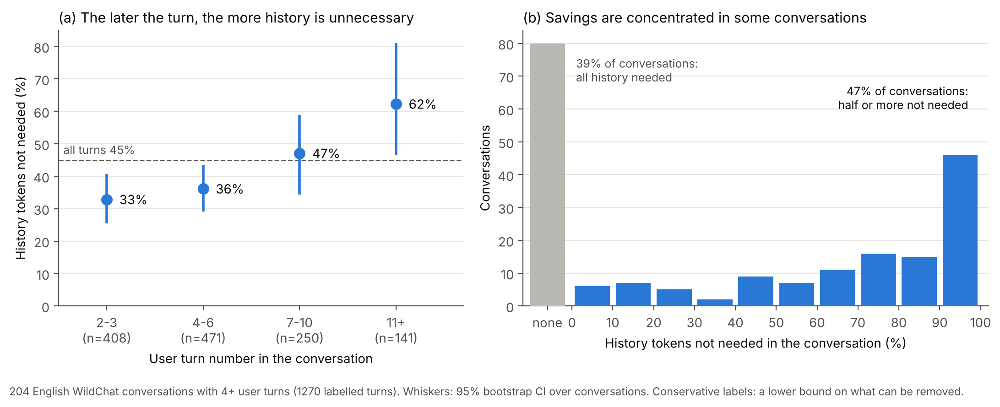
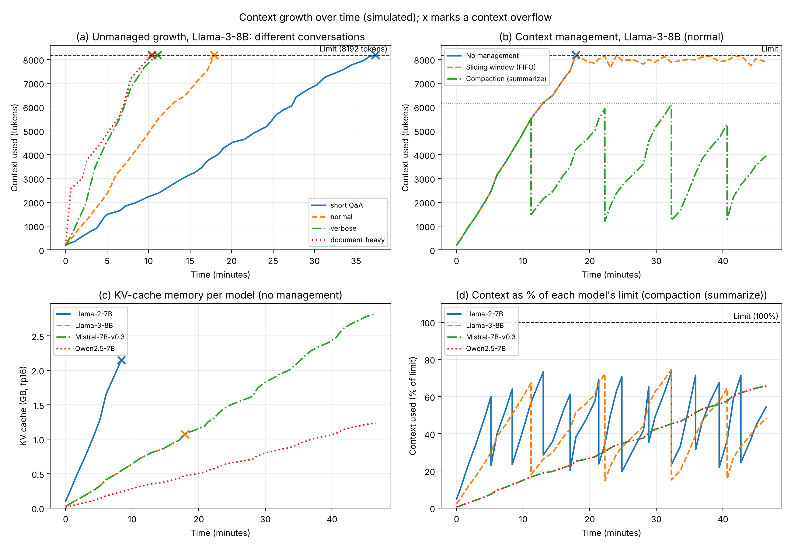

# GreenContext

**How much of the conversation history that LLM assistants re-read is actually needed, and what does carrying it cost?**

Chat and coding assistants send every earlier message and reply back to the model on every turn. The cost of each answer therefore grows with the length of the session, the KV cache fills GPU memory, and long sessions eventually hit the model's context limit. GreenContext is a research project at the University of Amsterdam on an agent-based memory layer that sends the model only the context each request needs, to cut the energy cost of AI assistants. This repository contains the two preliminary experiments behind the project proposal.

| Experiment | Question | Headline result |
| --- | --- | --- |
| [Pilot analysis](#1-pilot-how-much-history-is-actually-needed) | In real conversations, how much of the history sent with each turn is needed to answer it? | **45%** of history tokens were not needed (95% CI 37–53%), rising to **62%** after the tenth turn |
| [Context-growth simulation](#2-context-growth-simulation) | How fast does the context of a session grow, and what do sliding windows and compaction do with it? | Llama 3 8B reaches its 8,192-token limit after **10–37 minutes** of conversation; current approaches drop content by age or size, not by need |

## Repository layout

```
UvA_Impact_Call_2026/
├── pilot/                          # Experiment 1: real WildChat conversations
│   ├── data/
│   │   ├── conversation_ids.csv    # the 204 conversations used (raw text is downloaded, not stored)
│   │   └── README.md
│   ├── labels/
│   │   ├── PROTOCOL.md             # labelling rules
│   │   └── batch_01.txt … batch_12.txt
│   ├── scripts/
│   │   ├── fetch_wildchat.py       # download the conversations
│   │   ├── get_tokenizer.py        # fetch the BPE tokenizer used for counting
│   │   ├── build_views.py          # index conversations, write compact views for labelling
│   │   ├── compute.py              # token shares, bootstrap CIs, robustness checks
│   │   ├── plot.py                 # results figure
│   │   └── coding_subset.py        # coding vs other conversations
│   └── results/
│       ├── RESULTS.md              # full write-up
│       ├── results.json, coding_subset.json, turn_level_results.csv
│       └── unneeded_context.png / .pdf
├── simulation/                     # Experiment 2: context growth over time
│   ├── context_growth_experiment.py
│   └── results/
│       ├── records.csv
│       └── context_growth.png / .pdf
├── requirements.txt
├── LICENSE
└── README.md
```

## Quick start

```bash
git clone https://github.com/pial08/UvA_Impact_Call_2026.git
cd UvA_Impact_Call_2026
python -m venv .venv && source .venv/bin/activate
pip install -r requirements.txt

# Experiment 1: reproduce the pilot from the published labels
cd pilot/scripts
python fetch_wildchat.py --ids ../data/conversation_ids.csv --out ../data
python get_tokenizer.py --out ../data
python build_views.py ../data ../views
python compute.py ../data ../labels ../results
python plot.py ../results
python coding_subset.py ../data ../results

# Experiment 2: regenerate the simulation figure
cd ../../simulation
python context_growth_experiment.py --mode analytic
```

The pilot scripts reproduce `results.json` exactly when run on the listed conversations. The simulation is deterministic (seed 7).

---

## 1. Pilot: how much history is actually needed?

### Data

[WildChat-1M](https://huggingface.co/datasets/allenai/WildChat-1M) (Zhao et al., ICLR 2024) contains real ChatGPT conversations from 2023. We drew 40 random blocks of 100 consecutive rows, of which 26 downloaded, and kept English conversations that were not flagged toxic, not redacted and had at least four user turns: **204 conversations with 1,474 user turns, 1,270 of which have earlier history.**

### Method

A *turn* is one user message and the assistant's reply. At turn *t*, chat systems send turns 1 to *t*−1 back to the model as history.

1. **Labelling.** For every turn, a labeller recorded which earlier turns the model needs to answer it as the user intends. Codes: `P` (new topic or self-contained, needs no history), `S` (continues the current thread since the last `P`), `A` (needs everything) or an explicit list such as `1,3-4`. The rules are deliberately conservative: when in doubt, history counts as needed, and follow-ups such as "continue" or "make it shorter" keep their whole thread. The result is therefore a **lower bound** on what could be removed. See [`pilot/labels/PROTOCOL.md`](pilot/labels/PROTOCOL.md).
2. **Counting.** Tokens were counted with a BPE tokenizer (the legacy Claude tokenizer; shares are insensitive to the choice).
3. **Measure.** Share of history not needed = Σ(history tokens − needed tokens) / Σ history tokens, over all turns.
4. **Uncertainty.** 95% confidence intervals from 10,000 bootstrap resamples of conversations.

### Results

| Measure | Value (95% CI) |
| --- | --- |
| History tokens not needed | **45%** (37–53%) |
| All input tokens not needed (history and current message) | 42% (34–49%) |
| Turns that need no earlier turn at all | 33% (27–40%) |
| History not needed at turns 2–3, 4–6, 7–10 and 11+ | 33%, 36%, 47%, 62% |
| Conversations that need all their history | 39% |
| Conversations with half or more of their history not needed | 47% |
| Conversations exceeding 4,096 tokens (all, coding, other) | 26%, 42%, 19% |



**Coding conversations.** 60 of the 204 conversations contain code. They are longer (median 8 turns versus 5), hold 47% of all history tokens and exceed 4,096 tokens twice as often. A smaller share of their history is not needed: 34% (19–45%), against 55% for other conversations, and 50% after the tenth turn. Coding sessions are usually one continuous task, and turn-level labels cannot remove an outdated version of the code inside a turn that is still needed, so this estimate is especially conservative.

**Robustness.** If every topic switch still kept the previous turn, 39% (31–46%) of history would remain unneeded. Excluding identical resubmissions gives 44%; removing the ten conversations that contribute most gives 34%.

### Limitations

- **One LLM labeller.** Labels were made by Claude from clipped views of each conversation. A spot check of 18 turns labelled as needing no history found all 18 correct. A human check of a larger subset is planned.
- **WildChat is not all assistant use.** It over-represents homework question series and repeated prompt templates, which raise the share, and has no system prompts, which would lower it.
- **Tokens, not energy.** With prefix caching, unneeded history is not recomputed, but it still occupies KV-cache memory and is read for every generated token. Energy savings must be measured.
- **Quality not tested.** The labels say what should be sufficient. Whether answers stay as good with only that context is the next experiment.

The full write-up is in [`pilot/results/RESULTS.md`](pilot/results/RESULTS.md).

---

## 2. Context-growth simulation

[`simulation/context_growth_experiment.py`](simulation/context_growth_experiment.py) shows how the context of a session grows over time and what current management strategies do with it.

### What it models

**Models** (published configurations; KV cache = 2 × layers × KV heads × head dimension × 2 bytes per token):

| Model | Layers | KV heads | Head dim | Context limit | KV cache per token |
| --- | --- | --- | --- | --- | --- |
| Llama 2 7B | 32 | 32 | 128 | 4,096 | 512 KiB |
| Llama 3 8B | 32 | 8 | 128 | 8,192 | 128 KiB |
| Mistral 7B v0.3 | 32 | 8 | 128 | 32,768 | 128 KiB |
| Qwen2.5 7B | 28 | 4 | 128 | 32,768 | 56 KiB |

**Conversation styles** (log-normal message lengths; median user / assistant tokens): short Q&A 40 / 150, normal 80 / 400, verbose 150 / 900, and document-heavy 100 / 500 with a 1,500–5,000-token paste in 15% of user messages. Each turn adds 15–90 s of reading and typing plus generation at 30 tokens/s; a 200-token system prompt is always present.

**Strategies:**
- **No management:** the context grows until it overflows the limit.
- **Sliding window:** the oldest messages are dropped to stay under the limit.
- **Compaction:** when the context would pass 75% of the limit, the history is replaced by a summary a tenth of its size (at least 300 tokens) plus the last exchange.

### Results



- **(a)** Without management, Llama 3 8B reaches its 8,192-token limit after 10 minutes (document-heavy), 11 (verbose), 18 (normal) or 37 (short Q&A). Llama 2 7B overflows after 4–19 minutes.
- **(b)** The sliding window drops old messages in 24 of 40 turns; compaction summarises the history four times in 47 minutes. Neither selects content by relevance.
- **(c)** KV-cache memory grows linearly with context. At its 4,096-token limit, one Llama 2 7B session holds 2.1 GB, about twice as much as Llama 3 8B at 8,192 tokens, because grouped-query attention stores fewer key-value heads.
- **(d)** With compaction, smaller limits mean more summarising: 11 times for Llama 2 7B, 4 for Llama 3 8B and none for the 32K models in the normal conversation.

This is an illustration from model configurations, not a measurement.

### Measure mode

The same script can run real Hugging Face chat models turn by turn. It counts tokens with each model's chat template, reads the actual KV-cache size from `generate()`, and records peak GPU memory:

```bash
pip install torch transformers accelerate
python context_growth_experiment.py --mode measure \
    --models Qwen/Qwen2.5-0.5B-Instruct HuggingFaceTB/SmolLM2-360M-Instruct \
    --limit 2048 --turns 30 --max-new-tokens 256
```

Other options: `--strategies none sliding compaction`, `--compact-threshold 0.75`, `--x turn` (turns instead of minutes on the x-axis), `--plot-only results/records.csv` (re-plot a previous run). Run `python context_growth_experiment.py --help` for the full list.

---

## Data and licences

- **Code, labels and results** in this repository: Apache License 2.0 (see [`LICENSE`](LICENSE)).
- **WildChat-1M** is released by the Allen Institute for AI under the ODC-BY licence. This repository stores only row indices, conversation hashes and labels; the conversation text is downloaded by `fetch_wildchat.py` from the public Hugging Face datasets-server API.
- **Tokenizer:** `get_tokenizer.py` extracts the tokenizer file from the MIT-licensed `anthropic` Python SDK (version 0.34.2).

## Citation

If you use the pilot labels or code, please cite this repository and the WildChat dataset:

```bibtex
@misc{greencontext2026,
  author = {Nafis Tanveer Islam},
  title  = {GreenContext: how much conversation history do LLM assistants need?},
  year   = {2026},
  url    = {https://github.com/pial08/UvA_Impact_Call_2026}
}

@inproceedings{zhao2024wildchat,
  title     = {WildChat: 1M ChatGPT Interaction Logs in the Wild},
  author    = {Zhao, Wenting and Ren, Xiang and Hessel, Jack and Cardie, Claire and Choi, Yejin and Deng, Yuntian},
  booktitle = {International Conference on Learning Representations (ICLR)},
  year      = {2024}
}
```

## Contact

Nafis Tanveer Islam, University of Amsterdam · GitHub [@pial08](https://github.com/pial08)
